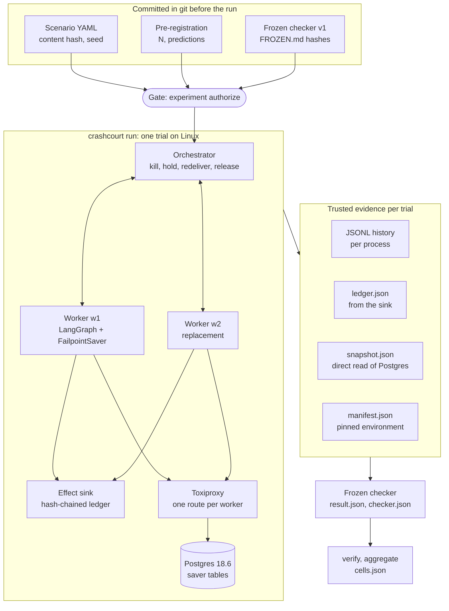

# CrashCourt

**Deterministic fault injection and conformance testing for durable AI-agent runtimes.**

Agent runtimes such as LangGraph save a checkpoint after each step so that a crashed run can resume
where it stopped. CrashCourt tests what actually happens when it does. It kills or holds agent worker
processes at exact points inside the checkpoint saver's calls, redelivers their work to a replacement
process, then judges each outcome against the runtime's documented guarantees. The evidence comes from
sources the runtime does not
control: an independent ledger of external side effects, per-process event histories, and a direct
read of the database.

The first target is LangGraph 1.2.12 with its Postgres checkpointer (`langgraph-checkpoint-postgres`
3.1.2) on Postgres 18.6, under `durability="sync"`.

**Status (October 2026).** Two LangGraph failure modes that others reported publicly are reproduced as
formal, pre-registered batches on GitHub Actions, each in 20 of 20 trials. They are replications that
validate the instrument, not new findings. No original finding is claimed here.

## Results: two formal replications

| | K1a: crash, redelivery, duplicate effect | K3: stale-worker takeover, checkpoint fork |
| --- | --- | --- |
| Replicates | [langgraph#8039](https://github.com/langchain-ai/langgraph/issues/8039) | [langgraph#8796](https://github.com/langchain-ai/langgraph/issues/8796) |
| Workload | W1: plan, human approval (`interrupt()`), then `execute` posts one `charge` effect | W5: one chat turn on one thread, answered by a scripted model |
| Fault | Worker w1 is killed (SIGKILL) after `execute` has posted its charge and before the node's pending writes are committed. The resume is redelivered to worker w2. | w1 is held just before it saves the turn's checkpoint. The turn is redelivered to w2, which completes it. Then w1 is released. |
| What the oracle recorded | Two `charge` rows in the effect ledger: attempt 1 from w1, attempt 2 from w2 | One checkpoint with two committed children in Postgres, one written by each worker; the thread's head is w2's |
| Frozen checker | I4 and I7a GAP (a duplicate effect and an orphaned effect that no documented clause covers); I1a, I1b, I11 PASS | I5a GAP (forked lineage) and I6a GAP (the head of a thread with two writers); I1a, I1b, I11 PASS |
| Trials | 20 of 20 valid; every invariant and observation as predicted | 20 of 20 valid; every invariant and observation as predicted |
| Formal run | [Actions run 38964246590](https://github.com/s2002kumar/crashcourt/actions/runs/38964246590) | [Actions run 38976681097](https://github.com/s2002kumar/crashcourt/actions/runs/38976681097) |

Each anomaly appeared in 20 of 20 trials (Wilson 95% interval 0.84 to 1.00). Each batch ran from the
commit that pre-registered it: [6e56791](https://github.com/s2002kumar/crashcourt/commit/6e56791) for K1a and
[4e4e0a9](https://github.com/s2002kumar/crashcourt/commit/4e4e0a9) for K3.

**What these results establish**

- **The fault lands where it is declared.** The kill and the hold fire at a named saver call, located
  by an audited landmark rather than by timing, and the work moves to a replacement process. A fault
  that fires anywhere else makes the trial INVALID; no trial was INVALID.
- **The oracle sees what the runtime's own answers do not.** In K1a the first charge is missing from
  the thread's saved state and appears only in the effect ledger. In K3 the turn completed normally and
  the saver's latest read returns w2's checkpoint; the second child shows in the snapshot's raw rows.
- **The checker scores each anomaly against the documentation as written.** Both are GAP. LangGraph's
  documentation says that handling a second run on a thread before the first finishes is not part of
  the open-source framework (K3). It describes pending writes without saying what a process crash does
  to them (K1a). A GAP marks behavior the documentation does not cover; it is not a bug report.
- **The outcomes are reproducible from the recorded evidence.** Running the frozen checker again over
  the same histories gave byte-identical output for all 40 trials. `crashcourt experiment verify`
  checks each batch against git history (see [Inspect the formal evidence](#inspect-the-formal-evidence)).
- **Outcomes did not vary between trials.** Every trial of each batch had the same outcomes. In K3
  every process's event sequence was also identical in all 20 trials. In K1a the orchestrator's was
  identical, and the workers' differed only in where an asynchronous `put_writes` return landed (w1 in
  2 trials, w2 in 3).

They do not establish anything new about LangGraph, how often these failures occur in production, or
how other savers, durability modes, or versions behave.

**Where the evidence is.** Both batches are stored as artifacts of their Actions runs
(`experiment-K1a-gh38964246590-1` and `experiment-K3-gh38976681097-1`), which GitHub keeps until
2027-01-14. They are not committed to this repository. Each artifact holds the gate's authorization,
the fault self-test from the same runner, every trial's histories, ledger, snapshot, and checker
output, and the classify, verify, and aggregate output.

An earlier K1a batch ([run 38926456031](https://github.com/s2002kumar/crashcourt/actions/runs/38926456031))
showed the same behavior in 20 of 20 trials. Its prediction named only 3 of the 14 invariants, so the
aggregator recorded the others without a prediction and the gate did not accept it. It stays archived
as it ran and is not counted. The Deviations section of
[research/preregistration.md](research/preregistration.md) records why K1a ran again.

## How it works



1. **Pre-register.** A scenario file names the workload, the worker processes, the client operations,
   and a schedule of trigger-action steps. It is validated and content-hashed.
   [research/preregistration.md](research/preregistration.md) commits each cell's scenario hash, seed,
   trial count, and predicted outcome for every invariant before its batch runs.
2. **Authorize.** `crashcourt experiment authorize` refuses, listing every reason, unless the checkout
   is clean, the checker matches the hashes in its `FROZEN.md`, and the scenario, seed, and trial count
   match the pre-registration. Formal batches run only through the
   [experiment workflow](.github/workflows/experiment.yml), from `main`, on GitHub-hosted Ubuntu 24.04.
3. **Run.** `crashcourt run` first checks the environment (`doctor` writes a manifest of pinned
   versions and image digests), then spawns two worker processes per trial. Each runs a
   LangGraph graph through `FailpointSaver`, a wrapper around the real saver that records every call
   and can hold the call or kill the process at a named point. The orchestrator acts as the client. It
   sends operations over Unix sockets and fires schedule steps on events (a failpoint hit, a worker's
   exit, every named barrier held, an operation ending), not on timers.
4. **Record.** Each process appends its own JSONL history. Workers post external effects to the effect
   sink, a separate process with an append-only, hash-chained SQLite ledger outside the fault path.
   After the trial the runner reads the saver's tables directly, in one repeatable-read transaction,
   keeping each row's `xmin` and commit timestamp.
5. **Judge.** The frozen checker is a pure function of those records: no network, no clock, and nothing
   from the target's own API. It orders events only by causal edges between processes. Any failed
   integrity check, such as a fault that did not fire at its declared landmark, makes the trial
   INVALID. Otherwise the checker evaluates each invariant and classifies it against the clause
   registry.
6. **Re-check and summarize.** `experiment classify --compare` runs the checker again and requires
   byte-identical output. `experiment verify` checks a batch against git history. `experiment
   aggregate` writes `cells.json`: counts, Wilson intervals, and each prediction beside what was
   observed. Batches are pooled only when their environments match.

**Outcomes.** The checker gives each invariant one of these outcomes:

| Outcome | Meaning |
| --- | --- |
| PASS | Exercised, no anomaly, and a documented guarantee covers it |
| NO_ANOMALY_UNSPECIFIED | Exercised and no anomaly, but no documented guarantee covers it, so it is not reported as PASS |
| EXPECTED | An anomaly that a documented permission covers, with every condition the permission states witnessed |
| GAP | An anomaly that no clause covers, or that the documentation disclaims |
| VIOLATION_CANDIDATE | An anomaly that a documented guarantee forbids. It starts an escalation; a VIOLATION is written only by hand, after review |
| INVALID | The trial cannot be used as evidence; the reason is named |

An invariant that a trial did not exercise gets no outcome and is not counted as PASS. The 14
invariants cover durability (I1a sync ordering, I1b acknowledged checkpoints survive, I11 a client OK
implies durable), re-execution (I2 committed task writes are not re-run, I4 every duplicate effect has
a documented cause), lineage (I5a-c the thread's checkpoints form a chain and every row is readable,
I6a-b the head is correct and does not regress), and effects (I7a-c no orphaned or phantom effects and
the effect matches the approval, I8 resume values are intact).

## Design decisions

- **Faults are placed by saver call, not by timing.** A failpoint names a method, a phase such as
  `put_writes.before`, and an occurrence. Every armed step must also name an audited landmark, such as
  L-EXW (execute's task writes). Each landmark's occurrence was derived from real fault-free histories
  rather than from reading the source. The checker makes the trial INVALID if the hit lands anywhere
  else. The cost is that each new runtime version needs its landmark table audited again.
- **The oracle is independent of the target.** The effect ledger is the only definition of "an effect
  happened". It runs in its own process, outside the fault proxy, does not deduplicate, commits before
  it answers, and hash-chains its rows. Attempt counters live in the sink, so a replacement worker
  cannot restart them at 1. What the target reports about itself (for example `get_state_history`) is
  a claim to check, not evidence.
- **No clocks in a verdict.** Events are ordered by sequence number within a process and only by causal
  edges (dispatch, barrier, effect, exit, result) across processes. Events that no chain connects are
  treated as unordered. Each history line is one unbuffered append, so a SIGKILL loses at most the line
  being written.
- **Verdicts cite documentation.** Ten clauses quote their sources (nine from LangChain's documentation,
  one from the langgraph#8796 proposal) with the URL, the retrieval date, and the sha256 of the page.
  Each is tagged as a guarantee, permission, description, disclaimer, or proposal. A violation
  candidate needs a guarantee; without one the outcome is GAP.
- **Commitments live in git.** The checker was frozen before any formal batch: `FROZEN.md` records the
  hashes of its files, the clause registry, the workloads' effect models, and the landmark tables.
  Changing any of them means a new checker version beside the old one, not an edit. The gate and
  `verify` check the order of the freeze, the pre-registration, and the run in git history. Every
  change after a batch is logged under the pre-registration's Deviations.
- **Counts, not adjectives.** Every cell is reported as k of N with a Wilson 95% interval, and with a
  rule-of-three bound when k is 0. A deterministic cell that splits is marked UNSTABLE, and a cell
  above 2% INVALID is excluded. Generated sentences pass a linter that rejects words a count cannot
  support.
- **A pinned, recorded environment.** uv 0.12.1 with its own CPython 3.12.13, a locked dependency set,
  and container images pinned by digest. Every batch records them, with the host's CPU count and
  memory, and batches that differ in any material field are reported separately.

## What is and is not established

**Known-behavior replications.** K1a and K3 (above) reproduce behavior first reported in
langgraph#8039 and langgraph#8796. They show that the instrument detects a known duplicate effect and a
known fork, deterministically. Credit for the behaviors belongs to their reporters, and the
replications are not new findings.

**Instrument validation.** Recorded in [research/evidence/](research/evidence/); none of it is a result
about LangGraph.

- *Checker on fault-free runs:* 250 trials (five batches of 50 across both workloads), with 0 INVALID
  and 0 false anomalies. Fifteen sampled trials gave byte-identical output across a rerun, reversed
  histories, and shuffled snapshot rows ([checker validation](research/evidence/t-10/)).
- *Saver mutants (labeled test-only defects):* a missing parent, a swallowed commit failure, and a
  stale latest read were each caught by their intended invariant in 20 of 20 trials on the canonical
  runner. The other two specified mutants are not exercised by these workloads and are not counted
  ([first-discovery/c5.json](research/evidence/first-discovery/c5.json); the first measurement, which
  failed this check and was kept as it ran, is in [the instrument evidence](research/evidence/t-11/)).
- *Sequential reference:* the final state of fault-free Postgres runs equals the same operations on
  `InMemorySaver` in 50 of 50 trials for each workload
  ([first-discovery/c9.json](research/evidence/first-discovery/c9.json)).
- *Fault primitives:* lost and delayed acknowledgments, connection resets, backend termination, database
  restart, and signals each behave as the fault model assumes in 20 of 20 trials. The self-test runs
  again before every formal batch ([research/fault-selftest.md](research/fault-selftest.md)).
- *Source audit:* the pinned saver code's commit points and six ambiguous-commit windows, located by
  file and line, with each claim either tested against a real Postgres or marked as a reading
  ([research/source-audit.md](research/source-audit.md)).

**Unmeasured hypotheses.** Some of the source audit's readings have not been measured. They are
hypotheses, not results, findings, or violations. One example is reading R1: under `durability="sync"`,
a functional-API `@entrypoint` may run user code before its input checkpoint is durable. It was seen in
one in-process experiment and has not been measured as a pre-registered cell.

**Future original findings.** New-evidence cells are pre-registered, with their predictions, in
[research/preregistration.md](research/preregistration.md). One may run only after every instrument cell
of its tranche has come out as predicted under the same pre-registration commit and in the same
environment. The instrument cells are the negative and placebo controls, a forced-fork control, and the
published replications. No new-evidence result is reported in this README. An anomaly against a
documented guarantee would start an escalation before it could be called a VIOLATION: a rerun as a new
batch, the controls, a direct read of the rows, a standalone reproduction, a root-cause trace, a
prior-art check, and an independent review.

## Quickstart

Requirements: Docker with Compose, and [uv](https://docs.astral.sh/uv/) 0.12.1 (`pyproject.toml`
requires that exact version). Trials need Linux, or WSL2 on Windows. Node 24 is needed only for the
evidence explorer.

```bash
git clone https://github.com/s2002kumar/crashcourt.git
cd crashcourt
uv sync --locked --group dev          # uv's own CPython 3.12.13 and the locked packages
uv run pytest                         # unit tests; no Docker needed
docker compose up -d --wait --build   # Postgres :55432, Toxiproxy :8474, effect sink :8480 (127.0.0.1)
uv run crashcourt doctor              # checks the pinned environment, writes manifest.json
```

Images are pinned by digest in `compose.yaml`. After changing an image tag, run
`python scripts/pin_images.py` to pin it again.

### Run trials (Linux only)

`crashcourt run` drives two worker processes over Unix sockets and kills or holds them with POSIX
signals and barriers, so it refuses to start anywhere but Linux. On Windows, use a WSL2 shell with
Docker Desktop's WSL integration, from a clone on the Linux filesystem rather than under `/mnt/c`.

```bash
docker compose up -d --wait --build                    # the effect sink is built from this checkout
uv run crashcourt run scenarios/smoke.yaml --trials 5  # the harness end to end; no faults
uv run crashcourt run tests/integration/scenarios/t11-k1a-shape.yaml --trials 20
uv run crashcourt experiment classify runs/<batch>     # the frozen checker on every trial
```

`t11-k1a-shape.yaml` is K1a's schedule under its own name and seed. It runs as a development batch:
it is not pre-registered and cannot count as evidence. The [instrument evidence](research/evidence/t-11/)
records 20 such trials, all matching K1a's prediction. The pre-registered scenarios in
`scenarios/first-matrix/` run only through the gate, as canonical batches in the pre-registered
environment. Maintainers start them with
`gh workflow run experiment --ref main -f scenario=scenarios/first-matrix/K1a.yaml`.

`crashcourt faults selftest --trials 20` checks every fault primitive against the compose services
(it restarts Postgres; run `docker compose up -d --wait postgres` after it).

### Inspect the formal evidence

This needs neither Docker nor Linux. Download each artifact outside the clone, because `classify`
refuses a checkout with untracked files. Downloading needs a GitHub login (`gh auth login`).

```bash
gh run download 38964246590 --repo s2002kumar/crashcourt --dir ../cc-evidence/k1a
K1A=../cc-evidence/k1a/experiment-K1a-gh38964246590-1/runs/K1a-gh38964246590-1

uv run crashcourt experiment verify "$K1A"             # from main: checks the batch against git history

git checkout 6e56791 && uv sync --locked --group dev   # classify and aggregate run at the run commit
uv run crashcourt experiment classify --compare "$K1A" # 20 of 20 trials byte-identical
uv run crashcourt experiment aggregate "$K1A" --out ../cc-evidence/k1a-cells.json   # K1a: as-predicted
git checkout main
```

For K3, use run `38976681097`, the directory
`experiment-K3-gh38976681097-1/runs/K3-gh38976681097-1`, and commit `4e4e0a9`.

`verify` checks that the pre-registration was committed before the run commit and did not change in
between, that every hash matches the frozen checker, and that the batch has exactly the pre-registered
number of trials. A batch directory looks like this:

```text
K1a-gh38964246590-1/
  authorization.json  manifest.json  run.json  batch.json  scenario.yaml  scenario.json  summary.json
  K1a/trial-00001/
    orchestrator.jsonl  w1.jsonl  w2.jsonl  merged.jsonl   per-process histories, and a merged view
    trial.json        whether the harness controlled the trial, and the reasons if not
    ledger.json       the effect sink's rows and its hash-chain check
    snapshot.json     the saver's rows, read directly from Postgres
    sink-health.json  the sink's health before and after the trial
    checker.json      each invariant's outcome, clause, evidence pointers, and witnesses
    result.json       one outcome per invariant
```

In K1a, `ledger.json` holds the two charge rows, and `checker.json` cites them (`ledger#sink_seq=1`,
`ledger#sink_seq=2`) as the evidence for I4.

### Development checks

```bash
uv run ruff check . && uv run ruff format --check . && uv run pyright && uv run pytest
uv run pytest -m integration   # Linux, with the compose services up
```

## Evidence explorer

`site/` is a static Next.js site that renders the harness's artifacts and computes no verdicts. It
needs Node 24 (`site/.node-version`).

```bash
cd site
npm ci
npm run build          # static export to site/out, from the demo data in site/fixtures
npm run test:unit
npx playwright install chromium && npm run test:e2e
npm run build:release  # release build: reads ../results only, behind the release guard
```

For now it renders only labeled demo data (`uv run crashcourt fixtures --demo` regenerates it), and the
demo data is not a result. Every id starts with `DEMO-`, every record says `provenance: "fixture"`, and
every page that shows it carries a "Demo data — not a result" banner. A release build reads only harness
batches in `results/`. It fails on any fixture, on any `DEMO-` id, and when `results/` holds no batch.
No batch is in `results/` yet, so the formal batches above are not in the explorer.

`site/DESIGN.md` describes the visual system and `site/BUDGETS.md` the JavaScript budgets.

## Repository map

| Path | Contents |
| --- | --- |
| `src/crashcourt/orchestrator/` | the runner, dispatch and redelivery, barriers, worker processes |
| `src/crashcourt/worker/` | the worker process: runs graphs through `FailpointSaver` |
| `src/crashcourt/failpoints/` | `FailpointSaver`, the failpoint registry, barriers |
| `src/crashcourt/history/` | append-only per-process histories and their causal merge |
| `src/crashcourt/faults/` | signals, Toxiproxy toxics, backend termination, database restart, the self-test |
| `src/crashcourt/sink/` | the effect sink and its hash-chained ledger |
| `src/crashcourt/snapshot/` | the direct post-trial database snapshot |
| `src/crashcourt/checker/` | the frozen checker v1 and `FROZEN.md` |
| `src/crashcourt/experiment/` | the pre-registration model, the gate, verify, aggregate |
| `src/crashcourt/workloads/` | W1 (approval before an effect), W5 (continuation), the scripted model |
| `clauses/langgraph/` | the documented statements verdicts cite |
| `scenarios/` | scenarios; `first-matrix/` is pre-registered, `landmarks/` is the audited landmark table |
| `research/` | the pre-registration, the source audit, recorded evidence, gate notes |
| `site/` | the evidence explorer |
| `tests/` | unit, integration, audit, saver-mutant, and control tests |

## Limitations

- One runtime, one saver, and one durability mode so far: LangGraph 1.2.12, the async Postgres saver
  3.1.2, `durability="sync"`, Postgres 18.6. The async-durability cells wait on their landmark audit,
  and exit durability makes no `put_writes` call during a run, so K1a's kill point does not exist there.
- Two synthetic workloads with a scripted model and no LLM calls. They are built so that effects and
  lineage can be checked, not to resemble production traffic.
- 20 trials per fault cell. 20 of 20 bounds the rate from below at 0.84 (Wilson 95%). These cells test
  whether a schedule reproduces deterministically, not how often a failure occurs in production.
- Faults are process kills, held barriers, network toxics, backend termination, and database restarts
  on one host. Machine crashes and lost fsyncs are out of scope: trials kill processes, not the host.
- Two of the five specified saver mutants (a lost pending-write row, a by-id read) are not exercised by
  the current workloads, so the instrument's sensitivity to them is unmeasured.
- The formal batches are in Actions artifacts kept for 90 days, not in the repository.
- The project specification is private and is not in this repository; `spec-provenance.json` holds
  only its provenance metadata and sha256 hash.

## Related work and credits

- langchain-ai/langgraph#8796: write-ownership conformance proposal and SIGSTOP fork repro (bharatnpti).
  K3 replicates it.
- langchain-ai/langgraph#8039, #8234: sync-durability persistence ordering and post-crash recovery. K1a
  replicates #8039.
- langchain-ai/langgraph#8764: crash before the first durable checkpoint.
- mstevens843/crashpoint: crash-to-effect exactly-once measurements across five durable-execution engines.
- xbstack repros: independent fork and admission-ledger reproductions.
- AgentCI: evidence and authority fixtures for agent systems.

## License

MIT (see [LICENSE](LICENSE)).
