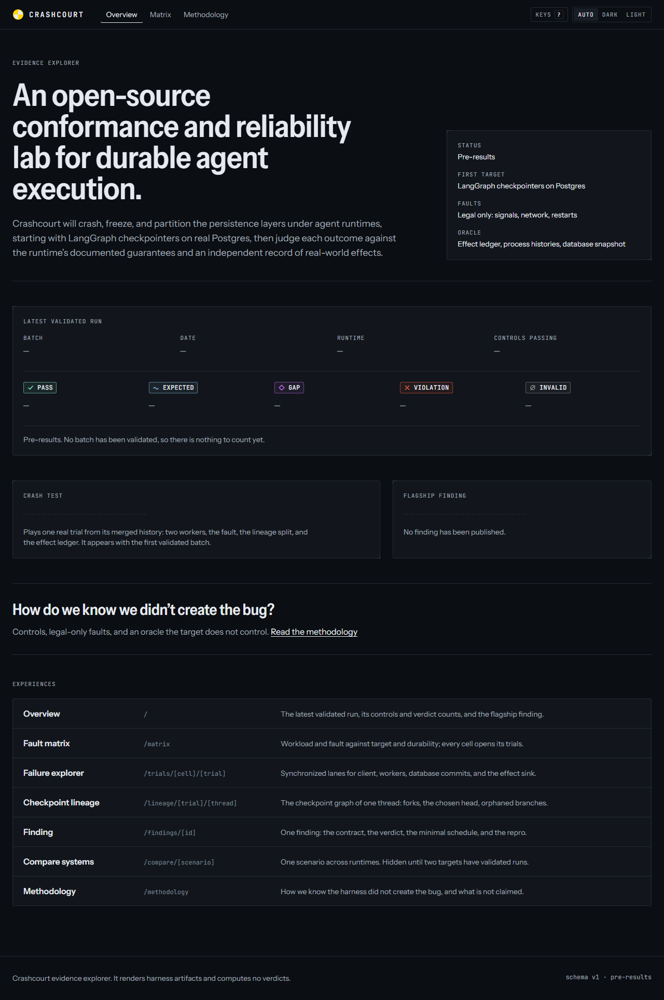
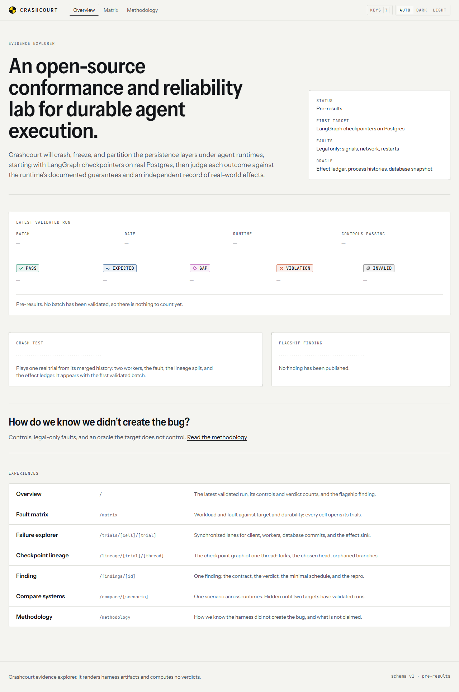
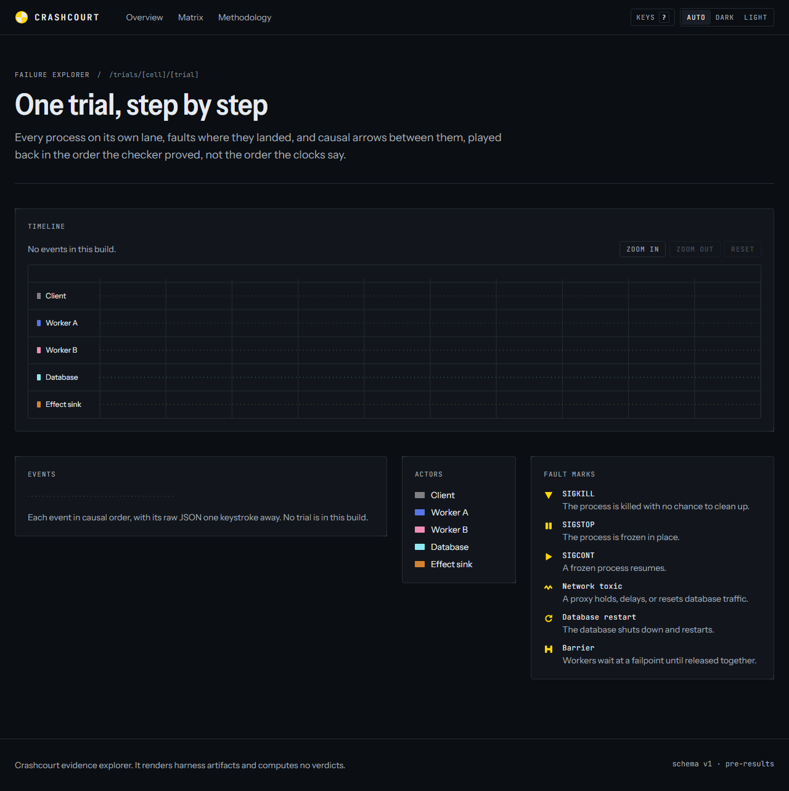
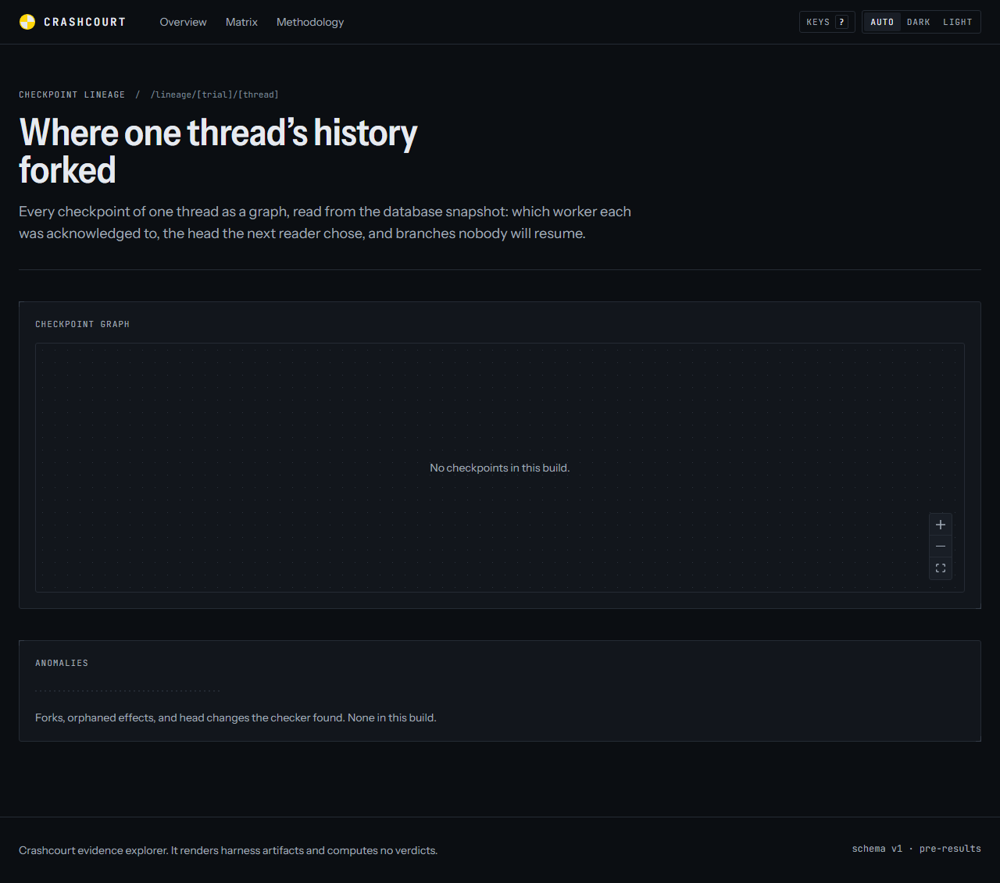
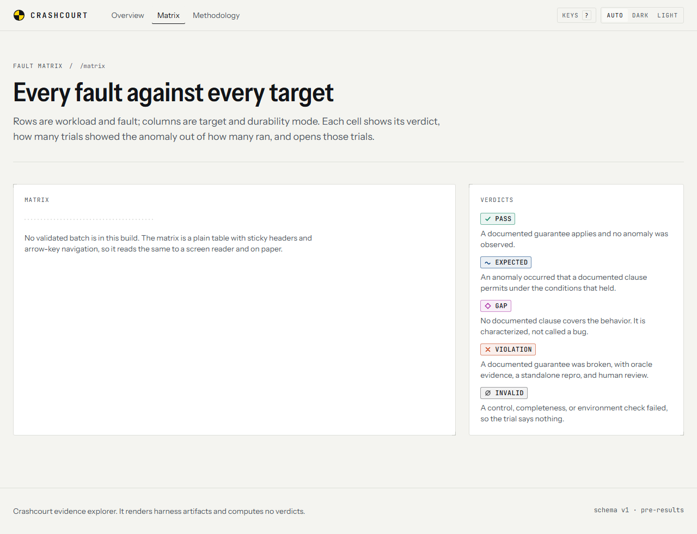
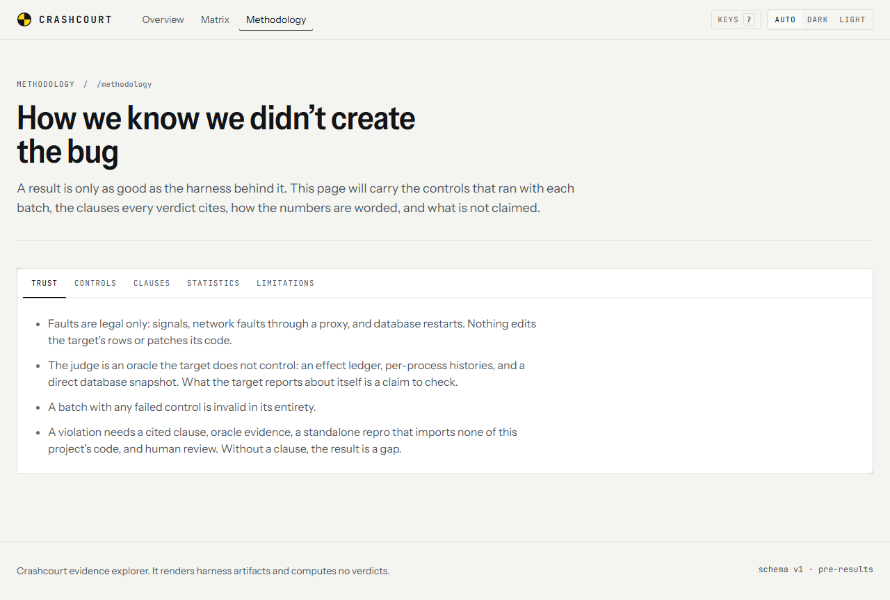
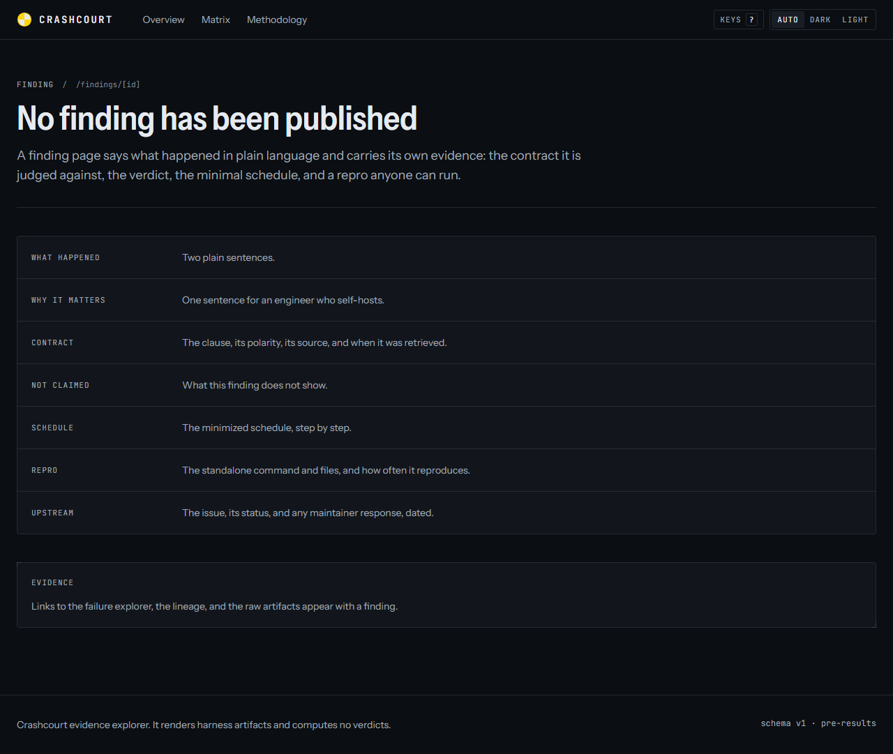
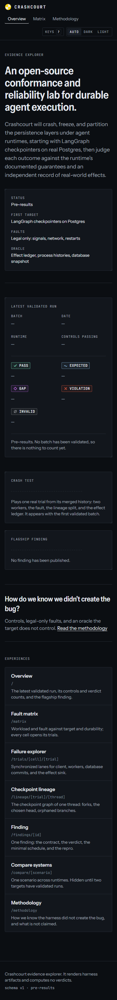

# Evidence explorer: design

The explorer is an instrument panel for a reliability lab: precise, calm, and legible at a glance. It shows
what the harness recorded and nothing it did not. Tokens live in `styles/tokens.css`; glyphs, labels, and
meanings live in `lib/tokens.ts`.

Status: **awaiting approval** (to be given in a PR comment).

## Principles

1. **Evidence, not decoration.** Pages render artifacts and compute nothing: no verdicts, no rates. An
   empty panel says so in one plain sentence, and a missing value is a dash, never a zero.
2. **One signal.** Crash-test yellow marks a fault or the keyboard's position, and nothing else. It
   comes from the black-and-yellow calibration targets on crash-test dummies, which is also the brand mark.
3. **Color is the third cue.** Every verdict has a glyph and a label, every actor a label and a fixed lane
   position, and faults are told apart by shape. Nothing depends on color alone.
4. **Calm motion.** Transitions are short and functional; `prefers-reduced-motion` removes them.
5. **The platform first.** Native elements where the platform has an accessible one (the keyboard dialog
   is a modal `<dialog>`, the theme switch is a radio group, the matrix will be a `<table>`); Radix where
   it does not (tabs now, tooltip and popover later); React Flow only on the lineage route. This keeps
   every page's JavaScript inside its budget (see BUDGETS.md).

## Typography

| Role | Face | Setting |
| --- | --- | --- |
| Prose and headings | Instrument Sans (variable: weight 400-700, width 75-100%) | Body 16px; lede 18px |
| Display | Instrument Sans at 87.5% width, weight 600 | 36-60px, line height 1.04, tracking -0.012em |
| Ids, routes, numbers | JetBrains Mono (variable) | Tabular figures and slashed zero, so readouts never jitter |
| Panel labels | JetBrains Mono, capitals | 11px, tracking 0.09em, muted ink: an engraved label on a panel |

A narrow grotesk for headings and a mono for everything the harness wrote down: a sentence reads as prose,
and an id or a count reads as data. Both fonts are OFL, installed from the lockfile (Fontsource) and
self-hosted with `next/font/local`; the build never fetches a font.

## Color

Every token is written once as `light-dark(<light>, <dark>)`. The site follows the reader's system
setting, is dark when there is none, and remembers an explicit choice (Auto, Dark, Light) in local storage,
applied before first paint.

`tests/unit/tokens.test.ts` parses `tokens.css` and fails the build unless:

- text colors (ink, muted, faint, accent text) reach 4.5:1 on every surface (WCAG 2.2, 1.4.3);
- actor colors, the focus ring, and the accent edge reach 3:1 (1.4.11);
- a verdict badge keeps its ink label at 4.5:1 and its colored glyph at 3:1 on its own tint;
- within the verdict set and within the actor set, each including the accent, the smallest CIEDE2000
  difference between any two colors is at least 20 for normal vision, and at least 10 (verdicts) or 9
  (actors) under simulated protanopia, deuteranopia, and tritanopia (Machado, Oliveira, and Fernandes 2009,
  full severity). The CIEDE2000 code is checked against Sharma, Wu, and Dalal's published test pairs.

**Surfaces and text** (light / dark; smallest contrast on any surface)

| Token | Light | Dark | Use |
| --- | --- | --- | --- |
| `--bg` | `#f4f4f0` | `#0b0e12` | Page |
| `--panel` | `#ffffff` | `#12161c` | Panels |
| `--raised` | `#fafaf7` | `#191e26` | Selected controls, keys |
| `--rule`, `--rule-strong` | `#dedfda`, `#c4c6c0` | `#252b34`, `#353d49` | Hairlines, registration marks |
| `--ink` | `#121418` (16.7:1) | `#e6eaf0` (13.9:1) | Text |
| `--ink-muted` | `#4c5360` (7.0:1) | `#a0aab7` (7.1:1) | Secondary text, labels |
| `--ink-faint` | `#5f6671` (5.3:1) | `#7f8997` (4.7:1) | Routes, dashes |
| `--accent` | `#ffd60a` | `#ffd60a` | Faults, brand; with `--accent-edge` (ink in light) for contrast |
| `--focus` | ink (16.7:1) | `#ffd60a` (11.9:1) | Focus ring, 2px with 2px offset |

**Verdicts.** The color marks the glyph, a 55% edge, and an 8% tint; the label stays in ink.

| Verdict | Glyph | Light | Dark | Meaning |
| --- | --- | --- | --- | --- |
| PASS | ✓ | `#027e5a` | `#80f1c8` | A documented guarantee applies and no anomaly was observed |
| EXPECTED | ~ | `#003b7a` | `#8fc1eb` | An anomaly a documented clause permits under the conditions that held |
| GAP | ◇ | `#ac34a6` | `#c267e8` | No documented clause covers the behavior; characterized, not called a bug |
| VIOLATION | ✕ | `#c2390d` | `#f35d40` | A documented guarantee broken, with evidence, a standalone repro, and review |
| INVALID | ∅ | `#545557` | `#898c90` | A control, completeness, or environment check failed; the trial says nothing |

Smallest pairwise difference (ΔE00), light / dark: normal 21.7 / 20.8, protanopia 10.3 / 19.9,
deuteranopia 11.7 / 13.3, tritanopia 15.7 / 11.0. Every verdict color is also at least 4.6:1 on plain
surfaces.

**Actors.** The same color for the same actor on every page.

| Actor | Light | Dark |
| --- | --- | --- |
| Client | `#4b4d50` | `#7e8083` |
| Worker A | `#3655cd` | `#5577e5` |
| Worker B | `#da4786` | `#f18db5` |
| Database | `#1d93a6` | `#8ceaef` |
| Effect sink | `#a65003` | `#d6812e` |

Smallest pairwise difference, light / dark: normal 23.5 / 22.0, protanopia 12.5 / 13.7, deuteranopia
17.7 / 13.9, tritanopia 11.6 / 9.5. Every actor color is at least 3.3:1 on every surface.

Tailwind's default palette is cleared (`--color-*: initial`), so a color outside the tokens cannot be used.

## Glyphs

Drawn as SVG (`components/glyphs.tsx`) so they are identical on every platform, and always beside a label.

- Verdicts: check, tilde, open diamond, cross, empty set, in the verdict's color.
- Fault marks, all in the accent with a dark edge: SIGKILL (downward triangle), SIGSTOP (two bars),
  SIGCONT (play), network toxic (zigzag), database restart (circular arrow), barrier (gate).
- Brand: a quartered disc with two accent quadrants, the crash-test target.

## Layout

- A 12-column grid, 82.5rem (1320px) wide at most, with 24px gutters (16px on phones).
- Panels are flat with a hairline border and two registration marks at opposite corners, 3px radius, and
  an engraved label.
- Evidence panels will slide in from the right (F-04); every state gets a deep link.
- Dynamic routes export one empty-state page (`/trials/none/none/` and so on) until artifacts exist,
  because a static export needs at least one page per route.

## Accessibility

- A skip link is the first stop on every page; every focusable element shows a 2px ring (tested on every
  route by tabbing through it).
- `?` opens a list of keys; pages with timelines and grids will add their own.
- Every visualization will have a synchronized table or text equivalent (spec section 17, rule 4); the
  timeline frame already names its lanes.
- axe reports no violations at any impact on every route in both themes; Lighthouse accessibility is 100.

## Never

"Safe" badges, leaderboards, fake live indicators, unlabeled demo data, or a number the artifacts do not
contain.

## Screenshots

Captured with `npm run screenshots` after a build (1280px wide unless noted; reduced motion).

| | |
| --- | --- |
|  |  |
|  |  |
|  |  |
|  |  |
